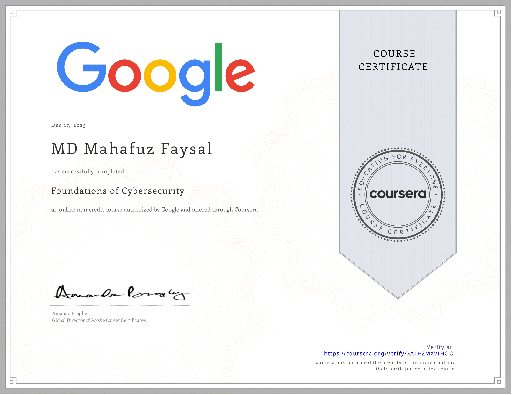
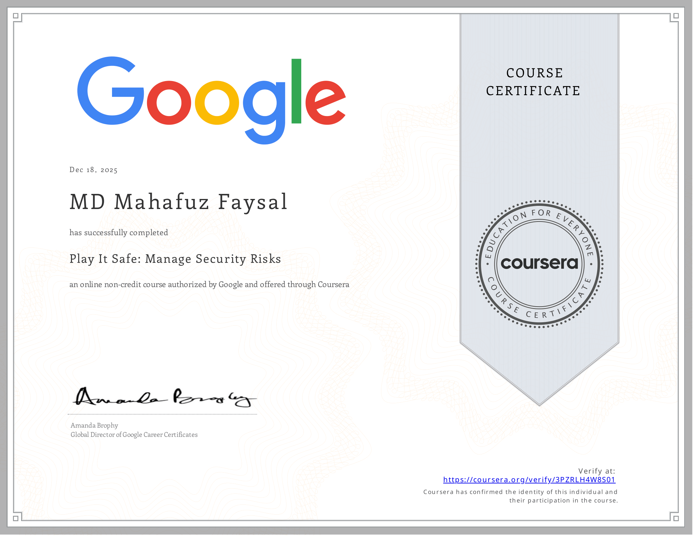
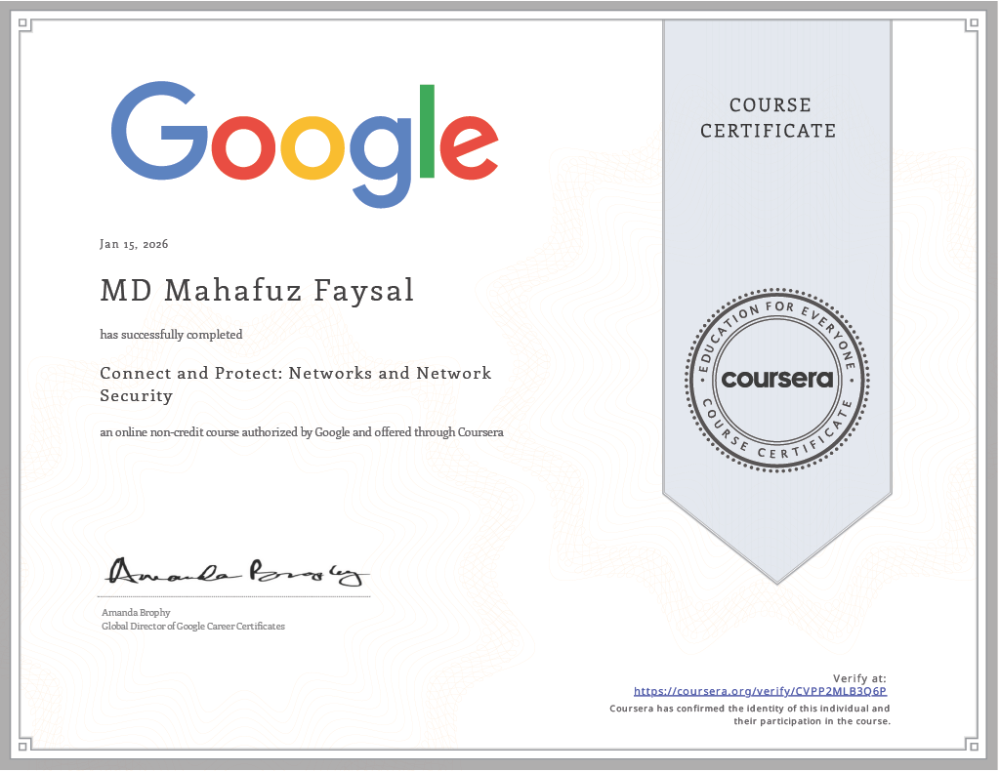
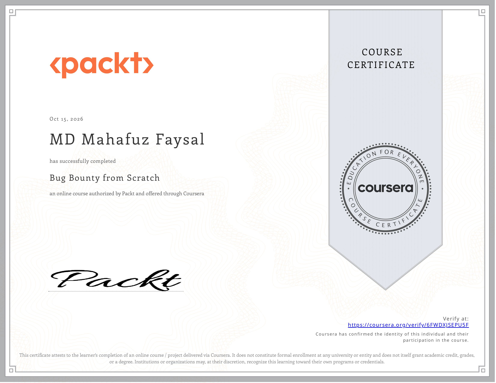

# 📜 Certifications

### Google Cybersecurity Professional Certificate
*Google — Coursera* · **In Progress**
- **Foundations of Cybersecurity** — Completed (December 2025) · [📄 Certificate](Certificates/Foundations-of-Cybersecurity.png)
- **Play It Safe: Manage Security Risks** — Completed (December 2025) · [📄 Certificate](Certificates/Play-It-Safe_Manage-Security-Risks.png)
- **Connect and Protect: Networks and Network Security** — Completed (January 2026) · [📄 Certificate](Certificates/Connect-and-Protect_Networks-and-Network-Security.png)

| Foundations of Cybersecurity | Play It Safe | Connect and Protect |
|---|---|---|
|  |  |  |

### Bug Bounty from Scratch
*Packt — Coursera* · **October 2026**
- Completed training in bug bounty methodology: reconnaissance, discovering and exploiting common web application vulnerabilities, and responsible reporting.

[← Back to Resume](README.md)
